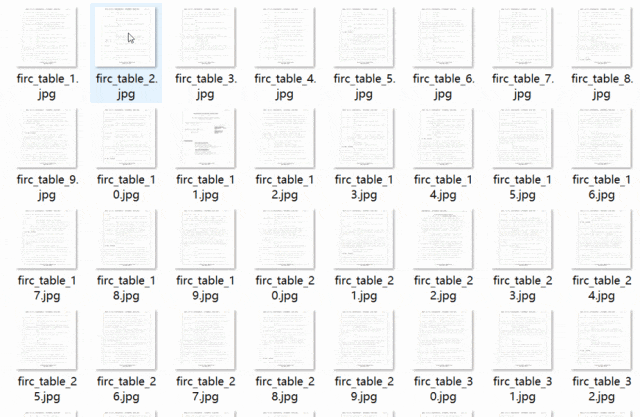
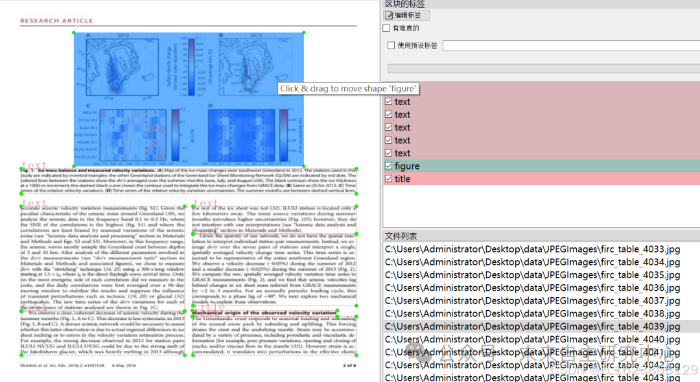
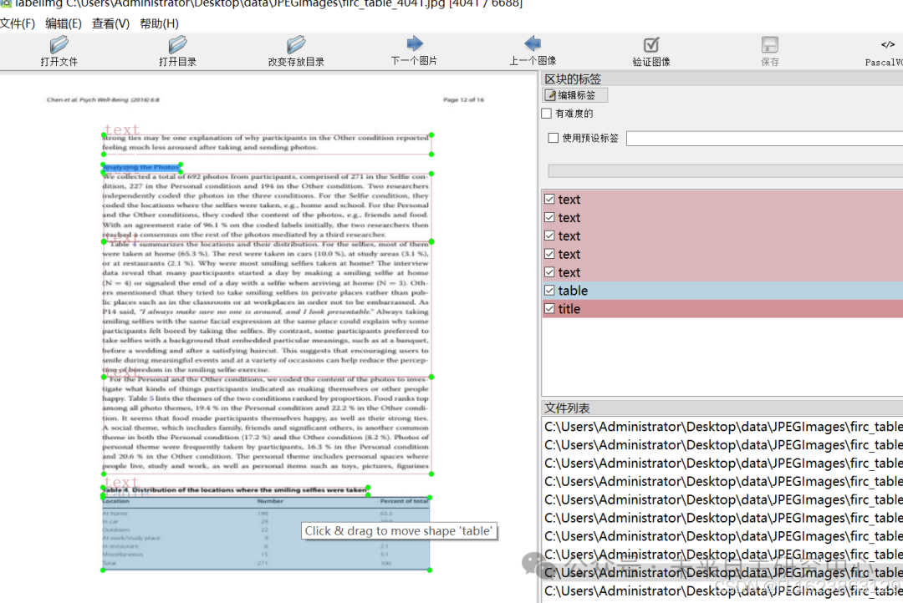

# [Dataset] [Object Detection] Text Table Detection Dataset VOC+YOLO format, 6688 images in 5 categories

Dataset format: Pascal VOC format + YOLO format (txt files without split paths, only containing jpg images and corresponding VOC format xml files and yolo format txt files)
Number of images (number of jpg files): 6688
Number of annotations (number of xml files): 6688
Number of annotations (number of txt files): 6688
Number of annotation categories: 5
Annotation category names: ["figure", "list", "table", "text", "title"]
Number of bounding boxes for each category:
figure = 3388
list = 1671
table = 1855
text = 45018
title = 10497
Total number of bounding boxes: 62429
Using labelImg for annotation
Annotation rules: Draw a rectangle around the category.
Important note: No guarantee is made regarding the accuracy or weights of the trained model. The dataset provides accurate and reasonable annotations only.

Image Preview:

Annotation example:

## Payment

Here is a pay link on Stripe ( https://buy.stripe.com/3cs8yP7sY87d0vu9AB ). Please contact me lonlonago@foxmail.com after funding $89, and I will send you a complete data files , thank you!

